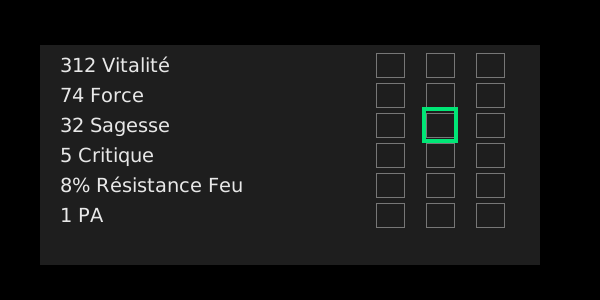

# forgemagie-dofus

Outil d'aide à la décision pour la forgemagie (FM) sur DOFUS :

- il **lit l'écran** en temps réel (fenêtre de FM) ;
- il **entoure en vert** la rune à cliquer (bonne ligne, bonne colonne Rune / Pa / Ra) ;
- il **suit le reliquat** (puits) coup après coup ;
- il calcule **l'ordre de clics** et **la liste de runes à acheter** pour un objet.

Les règles utilisées sont documentées dans [docs/REGLES_FORGEMAGIE.md](docs/REGLES_FORGEMAGIE.md), avec leurs sources.

> **Lecture seule.** L'outil ne clique jamais à ta place, ne lit pas la mémoire du jeu et n'intercepte pas le réseau : il fait une capture d'écran et dessine un cadre par-dessus. C'est toi qui cliques. L'automatisation de clics ou la lecture des paquets enfreindrait les conditions d'utilisation d'Ankama et exposerait ton compte à un bannissement.



## Pourquoi la capture d'écran ?

| Méthode | Verdict |
|---|---|
| **Capture d'écran + OCR** | ✅ Retenue. Sans risque pour le compte, marche avec Dofus 2 et Dofus 3, et une seule calibration suffit. |
| Lecture des paquets réseau / de la mémoire | ❌ Plus fiable, mais interdite par les CGU (risque de ban). |
| Saisie manuelle des valeurs | Possible avec la commande `plan --current ...`, mais trop lente pendant une FM. |

L'OCR peut se tromper : l'outil n'accepte une lecture que si **deux captures successives** donnent le même résultat. Le reliquat est estimé de façon prudente, et des boutons permettent de le corriger.

## Installation (Windows recommandé)

1. Installe **Python 3.10+** (coche « tkinter » / « tcl/tk », inclus par défaut sur Windows).
2. Installe **Tesseract OCR** avec le pack de langue **français** : https://github.com/UB-Mannheim/tesseract/wiki (coche *French* pendant l'installation).
3. Dans ce dossier :
   ```
   pip install -r requirements.txt
   ```

## Utilisation

### 1. Décrire l'objet
Crée un fichier JSON (voir `exemples/`). `min` et `max` correspondent au jet théorique, `current` à la valeur actuelle et `target` à la cible (par défaut le max). Les exos voulus vont dans `exos`.

```json
{
  "name": "Ma coiffe", "level": 200,
  "lines": [
    {"stat": "vitalite", "min": 301, "max": 350, "current": 312},
    {"stat": "force", "min": 61, "max": 80, "current": 64, "target": 85}
  ],
  "exos": {"pm": 1}
}
```
`python -m fmhelper stats` liste toutes les clés de stats possibles.

### 2. Préparer : ordre de clics et liste d'achats
```
python -m fmhelper plan exemples/coiffe_exemple.json
python -m fmhelper plan mon_objet.json --current "vitalite=330,force=70" --reliquat 46
```
La commande affiche l'ordre de clics conseillé (en supposant que tout passe), puis la liste de runes à acheter :
- **min** : le nombre de runes si chaque rune passe ;
- **médiane / p90** : le nombre de runes simulé sur 300 FM avec échecs (dans 90 % des cas, p90 runes suffisent).

Les exos ou overs lourds (PA, PM, PO, Invo) ne sont planifiés que si le reliquat les couvre. Pour les planifier quand même, ajoute `--forcer-exo`.

### 3. Calibrer (une fois par résolution / position de fenêtre)
Ouvre la fenêtre de FM en jeu avec ton objet, puis lance :
```
python -m fmhelper calibrate
```
Une capture plein écran s'affiche. Suis les 5 étapes : encadre les lignes de stats, puis clique au centre des cases Rune, Pa et Ra de la 1re ligne, et enfin au centre de la case Rune de la 2e ligne. Le résultat est enregistré dans `calibration.json`.

### 4. FM en direct
```
python -m fmhelper live mon_objet.json --reliquat 0
```
- Un **cadre vert** entoure la rune à cliquer, et le panneau affiche la rune, les chances estimées SC/SN/EC et le reliquat.
- Après chaque clic, l'outil relit l'écran, détecte l'issue (SC, SN ou EC), met à jour le reliquat et déplace le cadre.
- Les boutons **Reliquat −1 / +1 / =0** servent à corriger l'estimation (par exemple si le jeu affiche « −reliquat » alors que l'outil a supposé un SC).
- Chaque coup est enregistré dans `historique_fm.csv`. Cet historique servira à recalibrer les chances sur tes vraies données.
- Pour un **exo**, la ligne n'existe pas encore à l'écran : le panneau te dit quelle rune glisser dans la case de rune.
- Si Tesseract n'est pas trouvé : `--tesseract "C:\Program Files\Tesseract-OCR\tesseract.exe"`.

## Limites connues
- **Les chances affichées sont des estimations.** Ankama n'a jamais publié la formule. Le modèle (`fmhelper/probability.py`) suit les règles communautaires (palier 80 %, ×20, plancher 2 %, exo 1 %) et tous ses coefficients sont réglables dans `PARAMS`.
- Un SC et un SN absorbé par le reliquat donnent le même résultat à l'écran. L'outil suppose un SN (estimation prudente) : corrige avec les boutons si le jeu affichait un SC.
- La calibration suppose que les cases Rune / Pa / Ra sont alignées en grille à côté des lignes, comme dans l'interface de FM actuelle. Recalibre si tu changes la taille de la fenêtre.
- Testé sous Linux avec une fausse fenêtre de FM (OCR + cadre). Sous Windows, le mode plein écran transparent avec cercle vert n'a pas encore été testé en jeu.

## Développement
```
pip install pytest
python -m pytest -q
```
Structure : `runes.py` (base de runes), `model.py` (objet et reliquat), `probability.py` (chances), `planner.py` (choix de rune, plan, simulation), `ocr.py` (capture + Tesseract), `ui.py` (calibration, cadre, panneau), `__main__.py` (commandes).
